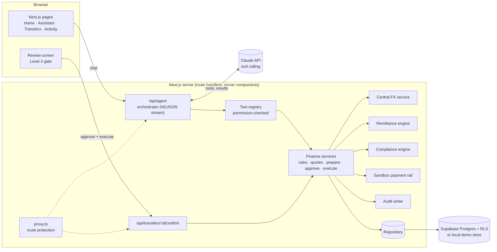

# CaiMao

**A scholarly cat that helps international students manage money across borders, while the student approves every payment.**

CaiMao (formerly the *CaiMao* MVP) is a competition entry for the theme *AI as a Financial Participant*. An international student (the demo user, Alex Tan, studies in the UK and is funded from Singapore) asks CaiMao to pay their tuition. The agent finds the invoice, reads balances, checks the transfer rules held in a regulatory database, compares remittance providers on what actually reaches the university, recommends a route, prepares the transfer and waits. Only when the student ticks *I reviewed this transfer* and presses **Confirm & Pay** does a sandbox payment execute. Balances update, the invoice is marked paid, and every step is written to an append-only audit log shown on the Activity & Security page.

```
Understand → Analyse → Check compliance → Compare → Recommend → Obtain approval → Execute → Verify
```

That sequence is visible on screen throughout the assistant workflow (route `/copilot`) and again, per run, on the Activity & Security page (route `/evidence`).

Beyond tuition, CaiMao is a **study-abroad financial setup assistant** for Singapore, China, the United Kingdom, the United States and Japan:

- **Statement analysis**: upload a PDF or CSV bank statement, check and confirm the extracted transactions, and get income, expenses, net cash flow, recurring payments, top merchants, categories, unusual costs and an *estimated* savings opportunity.
- **Cross-border rules**: what applies to money moving between two of the five countries, from a database of 79 rules verified against official sources, each with its regulator, source link and last-verified date. Anything not verified comes back as **NEEDS VERIFICATION**, never as a guess.
- **Banking abroad**: what banks ask for, which of 24 banks' accounts are open to international students, and how credit history works locally, based on nationality, residency, visa, age and student status.
- **My Financial Setup**: one personalised 8-step plan that ticks itself off as CaiMao sees each step done.
- **English, 简体中文 and 日本語** across the UI and the assistant.

> **Sandbox only.** No real money moves. The researched rules and banks were checked against official sources on 18 October 2026 and are guidance, not legal advice; the payment-gating rules in the tuition demo are **simulated** and labelled as such. FX rates are seeded demo rates.

**Submission documents:** [Technical documentation](docs/technical-documentation.md) · [Security self-assessment](docs/security-self-assessment.md) · [Execution evidence](docs/execution-evidence/README.md)

---

## Contents

1. [Product overview](#product-overview)
2. [Five-minute demo script](#five-minute-demo-script)
3. [Brand and design system](#brand-and-design-system)
4. [System architecture](#system-architecture)
5. [Technology stack](#technology-stack)
6. [Installation](#installation)
7. [Environment variables](#environment-variables)
8. [Database setup](#database-setup)
9. [Seed data](#seed-data)
10. [Running locally](#running-locally)
11. [AI architecture](#ai-architecture)
12. [Security design](#security-design)
13. [Sandbox execution](#sandbox-execution)
14. [Test cases](#test-cases)
15. [Deployment](#deployment)
16. [Project layout](#project-layout)
17. [Languages](#languages)
18. [Reference data](#reference-data)
19. [Known limitations](#known-limitations)

---

## Product overview

| Screen | Route | What it does |
| --- | --- | --- |
| **Splash → Intro** | `/welcome` | Orange splash with the CaiMao lockup, then *Study abroad. Manage money smarter.* with **Get started** (opens the demo account locally, or sign-up with Supabase) and **I already have an account**. Signed-out visitors to `/` land here. |
| **Home** | `/` | Greeting and route, a cocoa→orange balance card (hide/show, per-currency split), a CaiMao insight (*Your tuition is due in 12 days*, **See my options**), quick actions, account cards, a "Coming up" timeline with **Pay with CaiMao**, a spending donut and recent activity. |
| **Assistant** | `/copilot` | Conversation with CaiMao. Each reply opens with what CaiMao checked; **See what CaiMao checked** expands the real tool calls, permission levels and results. Tuition, funds and transfer requirements combine into one summary card; the **Best option** card has **Prepare payment**. Eight-step tracker on top, composer with quick prompts at the bottom. |
| **Transfer requirements → Review → Success** | review sheet | Opens when a transfer is prepared. **Ready to send?** lists each requirement from the stored compliance result (*Identity verified*, *Tuition invoice ready*, *Source of funds ready*, *University reference ready*, *Within the transfer limit*) with every rule one tap away. **Review your transfer** shows amounts, recipient, account, provider, fee, rate vs mid-market and arrival, then the acknowledgement box and **Confirm & Pay**. **Tuition paid** shows the receipt, **View receipt** and **Done**. |
| **Transfers** | `/transfers` | "You send / They receive" calculator with live quotes, providers ranked by what arrives (**Best value**), **See full comparison**, corridor rules with source and last-verified date, transfer history. |
| **Budget** | `/budget` | "Your October" hero, CaiMao's spending insights, category cards, upcoming bills, transactions. |
| **Bills & obligations** | `/obligations` | Tuition hero, **Upcoming / Paid / All** tabs, month grouping and urgency labels. |
| **Banking & Credit** | `/banking` | Card visual, next payment and minimum, payment history, *Build your UK financial profile* checklist and the local bank setup checklist per country. |
| **Analyse a statement** | `/budget/statement` | Upload (consent box, 5 MB, PDF/CSV), *Reading your statement…*, a review of every extracted row with editable categories and include toggles, **Confirm**, then the summary (income, expenses, net, recurring, potential savings), CaiMao insights, category breakdown, top merchants, recurring payments, unusual expenses, income pattern and a projection to the next big payment. Delete at any time. |
| **Banking abroad** | `/banking/abroad` | Per country: *About you* (nationality, residency, visa, age, student status), the 8 account-opening steps, bank comparison cards with **Check my eligibility**, and *Building credit history*, every fact with its source and last-verified date. |
| **My Financial Setup** | `/setup` | The 8-step plan for a study country (documents → bank account → receiving money from home → compare tuition routes → pay tuition → recurring payments → local credit → restrictions), with progress. |
| **Cross-border rules check** | `/transfers#rules` | Source, destination, purpose, amount and personal details → **COMPLIANT / ACTION REQUIRED / BLOCKED / NEEDS VERIFICATION** with requirements, documents, limits, regulator, official source and last verified. |
| **Activity & Security** | `/evidence` | Verified-transfer card, *How this payment happened* timeline, **Workflow evidence** (statement analysis, rule checks, banking setup, step by step), technical audit log, JSON export. |
| **Profile / Settings** | `/profile`, `/settings` | Identity, route, settings list, what CaiMao can do (permission level), activity summary; full settings incl. demo scenarios. |

Every status (Ready, Action needed, Blocked, Payment due, Best value, Completed, Pending approval, Paid) is shown as icon + word + colour, never colour alone.

---

## Five-minute demo script

1. Open the app: the **splash** plays, then the **intro**. Press **Get started** (local mode signs in as Alex Tan). Home shows the balance card and CaiMao's note: *Your tuition is due in 12 days. I found a route that could leave about GBP 254 more with Example University.*
2. Press **See my options**. CaiMao works ("Checking your accounts…", "Checking transfer requirements…") while the tracker fills in. The reply shows one summary card (tuition, available funds, **Transfer requirements: Ready**) and the **Best option** card.
3. Point out that **Home Bank charges no fee but delivers the least**; Panda Remit Demo gets about **GBP 254 more** to the university. Open **Compare all 3 routes** and **See what CaiMao checked** to show the real tool calls with their permission levels.
4. Press **Prepare payment**. The server re-checks the rules and prepares an instruction (*Your transfer is ready to review*, Level 2). The sheet opens on **Ready to send?** with each requirement and **See all 5 rules checked**.
5. Press **Review transfer**: *You send SGD 26,105.57 → Example University receives GBP 15,000.00*, account, provider, fee, exchange rate vs mid-market, arrival, **Requirements: Checked**, **Documents: Complete**. Tick **I reviewed this transfer**, press **Confirm & Pay**.
6. **Tuition paid**: transaction **UF-2026-000184**, new balance SGD 5,894.43. The tracker reaches *Verify*.
7. **Done → Home**: the balance has updated, CaiMao says *Your tuition is sorted*, and tuition shows **Paid** in the timeline.
8. **Activity & Security**: the verified-transfer card and the timeline (requirements checked → providers compared → approved by Alex → payment executed → balance updated → tuition marked paid). Open **View technical audit log** for every event.

New in this release, about a minute each:

9. **Budget → Analyse a statement**: tick the consent box, **Try the sample statement**, check a category, **Confirm**. Point out *Estimated opportunity*, not guaranteed savings, and that balances didn't change.
10. Ask the assistant *I'm a Chinese student moving to Singapore. How do I set up my finances?* It retrieves Singapore's requirements, banks and credit system, and **asks** for visa and residency before judging eligibility. Answer *I have my student pass and I've arrived*, then **Create my setup plan** and open **Setup**.
11. **Transfers → Cross-border rules check**: China → Singapore, education, USD 30,000 shows the regulator, documents, source and last verified. Then pick Vietnam → Japan to show **NEEDS VERIFICATION** and *I couldn't verify this requirement from the current regulatory database.*
12. **Settings → Language → 简体中文** (or 日本語): the UI and the assistant switch; bank names, regulator names and transaction IDs stay as they are.

Optional, 30 seconds each, from **Settings → Demo settings**:

- **Insufficient funds**: the agent stops after the funds check and prepares nothing.
- **Over the transfer limit**: the requirements row turns red (**Blocked**) and *This transfer can't go ahead* cites the SGD 200,000 demo rule; nothing is prepared.
- Under **Documents**, untick *Source-of-funds declaration*: requirements show **Action needed** and **Review transfer** stays disabled.
- Under **How CaiMao can help**, choose **View**: CaiMao can analyse, but its attempt to prepare a payment is blocked and logged as `PERMISSION_DENIED`.

## Brand and design system

The brand comes from the CaiMao logo (a cat with glasses on an open book, with money flowing between currencies) and the Canva landing design. Tokens live in `app/globals.css` (Tailwind 4 `@theme`).

| Token | Value | Use |
| --- | --- | --- |
| Primary (`brand`) | `#A84A1A` | Primary buttons, active nav, receive amounts, links. White text on it is 5.7:1 |
| Dark (`cocoa`) | `#3A2117` | Type, premium cards, user chat bubbles |
| Background (`ivory`) | `#FFF8F2` | Page surface |
| White | `#FFFFFF` | Cards |
| Soft cream (`cream`) | `#F6EADF` | Inset panels, secondary buttons |
| Gold | `#F5B14C` | Best value, current step halo, card chip, focus ring (text uses `#8A5300`) |
| Peach / Sand | `#F2C7A6` / `#E9D8C8` | Avatars, tiles, tracks |
| Insight surface | `#FFF1E4` with `#F4D2B9` border | CaiMao insight cards |
| Success / Warning / Error | `#3FAF6C` / `#F2A93B` / `#D85C4A` | Fills and soft surfaces. Text uses darker inks (`#23794A`, `#8A5300`, `#B23A2A`) to meet WCAG AA |
| Muted text | `#765B4D` | Labels; AA on white, ivory and cream |
| Premium gradient | `130deg, #3A2117 → #61311D 58% → #A84A1A` | Balance card, card visual, verified transfer |

- **Type:** Nunito Sans (headings, amounts) and Manrope (UI), both self-hosted variable fonts; Geist Mono for transaction IDs, FX rates and tool names.
- **Shape:** 20–28px radii, soft warm shadows (`0 14px 32px rgba(58,33,23,.07)`), raised orange glow on primary buttons.
- **Motion:** splash arrival and breathing, nudging arrows, drawn success check, gold halo on the current step, lift on hover and press on tap. All respects `prefers-reduced-motion`.
- **Brand assets:** `public/brand/caimao-lockup.png` (splash), `caimao-mark.png` (intro, login), `caimao-head.png` (mascot tile, readable down to 32px), `app/icon.png` and `app/apple-icon.png`. The logo background was recoloured from `#9F3D13` to the palette primary `#A84A1A` so it sits seamlessly on orange.
- **Components** (`components/app-shell.tsx`, `components/brand.tsx`, `components/caimao/`): `AppShell`, `NavRail`, `BottomNav`, `PageHeader`, `HeroBalanceCard`, `MascotInsightCard`, `QuickActionGrid`, `AccountCard`, `ObligationTimeline`, `TransferProviderCard` / `ProviderComparison` / `BestOptionCard`, `TransferSummaryCard`, `ChecklistCard`, `BankSetupChecklist`, `ActivityTimeline`, `CreditCardVisual`, `SettingsSection`, `EmptyState`, `SuccessState`, `SplashScreen`, `IntroScreen`, plus `PaymentSnapshot` and `AgentCardView` in `components/agent-cards.tsx`.
- **Layout:** slim white rail on desktop; on phones a top bar plus a docked bottom nav (Home, Transfers, raised CaiMao button, Budget, Profile), sticky composer and transfer button, bottom-sheet dialogs, 44px minimum touch targets.
- **Accessibility:** axe-core reports no WCAG 2 A/AA violations on any page at desktop and phone widths, including the welcome flow and the populated assistant. Focus is trapped in dialogs and Confirm & Pay can't be reached until the review box is ticked.

## System architecture



**Key decisions**

- **Read-only quotes for browsing.** The Transfers calculator calls `GET /api/quotes`, which runs the same engine as the agent but stores and logs nothing; only the agent's tool calls are audited.
- **One path for money.** The only way funds move is `POST /api/transfers/:id/confirm`, which first records the user's approval (`approveTransfer`, actor must be the user, acknowledgement must be `true`) and then runs `executeSandboxTransfer` against that approved request. The model has no tool that can approve or execute.
- **Server-side re-validation.** `createTransferInstruction` re-reads balances and re-evaluates compliance from the database; it does not trust anything the agent concluded earlier.
- **One FX service.** Every conversion goes through `lib/fx/service.ts`. Swapping seeded rates for a live feed means implementing `FxRateSource`.
- **Repository boundary.** `lib/data/repository.ts` has two implementations: `MemoryRepository` (local demo mode and tests) and `SupabaseRepository` (Postgres with RLS). The domain layer doesn't know which is in use.
- **Deterministic numbers.** Quotes, costs and rankings are pure functions of seeded rates and provider pricing, so the demo is reproducible and the tests are exact.

---

## Technology stack

| Layer | Choice |
| --- | --- |
| Framework | Next.js 16 (App Router, route handlers, server components, `proxy.ts`) |
| Language | TypeScript (strict) |
| Styling | Tailwind CSS 4, shadcn-style components on Radix primitives (Dialog, Checkbox, Collapsible, Slot), lucide icons, Geist font |
| Charts | Recharts |
| Database | Supabase PostgreSQL with row-level security; in-memory demo store when Supabase isn't configured |
| Auth | Supabase Auth (email + password) via `@supabase/ssr`; signed HMAC session cookie in local demo mode |
| AI | Anthropic Claude Messages API with tool use (`@anthropic-ai/sdk`), zod-validated tool inputs, JSON Schema generated from zod |
| Validation | zod |
| Tests | Vitest, PGlite (in-process PostgreSQL) for SQL and RLS tests |

---

## Installation

Requirements: Node.js 20+ (developed on 22) and npm.

```bash
git clone <your-repo-url> caimao
cd caimao
npm install
cp .env.example .env.local
```

That's enough to run in **local demo mode**. Supabase and an Anthropic key are optional.

---

## Environment variables

| Variable | Required | Purpose |
| --- | --- | --- |
| `NEXT_PUBLIC_SUPABASE_URL` | For Supabase mode | Project URL. |
| `NEXT_PUBLIC_SUPABASE_ANON_KEY` | For Supabase mode | Public anon key; all reads go through RLS. |
| `SUPABASE_SERVICE_ROLE_KEY` | For Supabase mode | **Server only.** Used for writes and for calling `commit_sandbox_execution`. |
| `UNIFLOW_DATA_MODE` | No | Force `memory` or `supabase`. Defaults to `supabase` when all three Supabase values are set. | (The `UNIFLOW_` prefix is kept from the original MVP so existing deployments keep working.)
| `DEMO_SESSION_SECRET` | Recommended | HMAC key for the demo-mode session cookie. Without it a random per-process secret is used. |
| `DEMO_USER_PASSWORD` | For seeding | Password for the seeded Supabase demo user. |
| `ANTHROPIC_API_KEY` | No | **Server only.** Enables the Claude tool-calling agent. Without it, the built-in planner runs the same tools. |
| `ANTHROPIC_MODEL` | No | Defaults to `claude-sonnet-5-5`. |
| `AGENT_MODE` | No | Force `llm` or `scripted`. |
| `SANDBOX_LATENCY_MS` | No | Simulated provider latency (default 600 ms). |
| `SANDBOX_FORCE_FAILURE` | No | `1` makes the sandbox rail reject payments, to rehearse the `FAILED` path. |

Nothing secret is prefixed `NEXT_PUBLIC_`, and no client component imports a module that reads secrets (server modules import `server-only`).

---

## Database setup

The schema lives in `supabase/migrations/0001_schema.sql` plus `0002_global_financial_setup.sql` (run both, in order). 0001 creates:

`users`, `profiles`, `accounts`, `transactions`, `obligations`, `budgets`, `country_rules`, `fx_rates`, `remittance_providers`, `remittance_quotes`, `transfer_requests`, `payment_executions`, `audit_logs`, `ai_conversations`, plus `credit_cards` and `bank_setup_checklist` for the Banking & Credit page.

It also defines:

- **Row-level security** on every table. Users can `SELECT` only their own rows; reference tables are readable by any signed-in user. There are **no** insert/update/delete policies on money tables. Users may update only `profiles.base_currency`, `profiles.ai_permission_level` (0–2 by check constraint), `profiles.documents_on_file` and `bank_setup_checklist.completed` (column-level grants).
- **`commit_sandbox_execution(...)`**, a `SECURITY DEFINER` function that locks the transfer request and account, verifies the request is `EXECUTING`, approved, acknowledged and compliant, checks the balance, then debits the account, inserts the execution and ledger entry, marks the obligation `PAID` and completes the request in one transaction. Execute permission is revoked from `anon` and `authenticated` and granted only to `service_role`.
- **Table constraints** that make an approved or executed request without an acknowledgement impossible (`approval_requires_ack`), and a non-compliant request impossible to execute (`no_execution_when_blocked`).
- **Append-only audit log**: a trigger rejects any `UPDATE` or `DELETE` on `audit_logs`.
- A trigger mirroring `auth.users` into `public.users`, and the `payment_txn_seq` sequence that produces IDs like `UF-2026-000184`.

`0002_global_financial_setup.sql` adds:

- Japan / JPY; profile fields `nationality`, `visa_type`, `residency_status`, `student_status`, `age`, `tax_residency`, `language` (user-updatable through column grants).
- Regulatory fields on `country_rules` (status `verified` / `simulated` / `needs_verification`, channel, direction, nationality/residency/visa conditions, regulator, evidence quote, translations) and a check that a **verified rule must have an official https source and a last-verified date**.
- Reference tables `banks`, `bank_account_requirements`, `credit_system_rules` (readable by signed-in users).
- `user_financial_setup` (journey progress), `statement_uploads` (metadata only; **the file is never stored**; masked account hint enforced by a check), `statement_transactions`, `statement_analyses`, all with select-own RLS and no client write policies, and `purge_expired_statement_previews()`.

Apply them with the Supabase CLI:

```bash
supabase link --project-ref <your-project-ref>
supabase db push
```

or paste the file into the Supabase SQL editor and run it.

---

## Seed data

`lib/seed.ts` is the single source of demo data, used by both stores. All dates are relative to the moment of seeding, so tuition is always due in 12 days.

- **User:** Alex Tan · home Singapore (SGD) · studying in the United Kingdom (GBP) · Example University.
- **Accounts:** Singapore Bank SGD 32,000 (****4821) · UK Bank GBP 3,200 (****7730) · Multi-Currency Wallet USD 1,000 (****3092).
- **Obligations:** University Tuition GBP 15,000 (TUITION-2026-001, due +12 days) · Rent GBP 850 (+18) · Student credit card GBP 320 (+5) · Mobile plan GBP 10 (+27).
- **Transactions:** ~35 over four months, categorised by `lib/budget/classifier.ts`.
- **Providers:** Home Bank (no fee, 2.2% FX margin), Panda Remit Demo (SGD 15 fee, 0.45% margin), Multi-Currency Wallet Demo (0.35% fee + SGD 4, 0.40% margin).
- **FX:** seeded mid-market rates for USD, GBP, SGD, CNY, HKD, VND.
- **Rules:** 14 **simulated** payment-gating rules for the tuition demo (China, Vietnam, Hong Kong, the United States, the United Kingdom, Singapore), plus 81 **researched** cross-border rules for SG, CN, GB, US and JP (79 verified against official sources), 24 banks, 5 account-opening overviews and 5 credit systems from `lib/reference/` (see [Reference data](#reference-data)).
- **Profile:** Alex is Singaporean, a full-time student on a student visa, age 21, interface language English.
- **Sample statement:** `public/samples/caimao-sample-statement.csv` and `.pdf`, fictional, 92 rows July–September 2026.
- **Scenarios:** `standard`, `insufficient_funds` (SGD 8,000), `over_limit` (GBP 120,000 tuition breaks the SGD 200,000 demo limit).

**Local demo mode** seeds itself on first use (stored in `.data/demo-db.json`; reset from Settings).

**Supabase:**

```bash
npm run db:seed -- --email alex.tan@demo.caimao.app --password 'a-strong-password'
```

This creates the Auth user (email pre-confirmed), writes reference data and Alex's dataset. Any other account that signs up is seeded automatically on first sign-in. *Reset demo* in Settings re-seeds the signed-in user; audit history is kept, because it is append-only.

---

## Running locally

```bash
npm run dev          # http://localhost:3000
npm test             # all tests
npm run lint         # type-check
npm run build && npm start
```

In local demo mode, sign in with **Continue as Alex Tan**. With Supabase configured, sign in with the seeded email and password.

---

## AI architecture

### Orchestrator

`lib/agent/orchestrator.ts` runs per message and streams events (`tool_start`, `tool_end`, `card`, `text`, `phase`, `suggestions`) to the browser as newline-delimited JSON.

- **Claude mode** (`ANTHROPIC_API_KEY` set): a tool-use loop of up to 14 steps. The system prompt sets the safety rules and the tuition workflow; the model decides which tools to call. Tool results go back to the model as JSON; the UI renders cards from those same results.
- **Built-in planner** (no key, or the model is unreachable): `lib/agent/scripted.ts` maps intents to fixed tool sequences and writes its narrative only from tool results. If the model call fails mid-request, the orchestrator says so and falls back to the planner with the same tools.

### Tools

| Tool | Level | Purpose | Offered to the model |
| --- | --- | --- | --- |
| `getUserProfile` | 1 | Countries, currencies, documents on file | ✓ |
| `getAccounts` | 1 | Masked accounts, balances, total in base currency | ✓ |
| `getTransactions` | 1 | 30-day budget summary and recent transactions | ✓ |
| `getObligations` | 1 | Obligations with days until due | ✓ |
| `getFXRate` | 0 | Mid-market rate from the central FX service | ✓ |
| `getTransferRules` | 1 | Rules for a corridor; with an amount, `COMPLIANT` / `ACTION_REQUIRED` / `BLOCKED` | ✓ |
| `getRemittanceQuotes` | 1 | Quotes from all providers | ✓ |
| `calculateTransferCost` | 0 | Total cost per route, ranked by recipient amount, with reasoning | ✓ |
| `createTransferInstruction` | 2 | Prepare (not send) a transfer; server re-checks funds and rules | ✓ |
| `getCreditSummary` | 1 | Card utilisation and due date | ✓ |
| `getBankSetupChecklist` | 0 | Account-opening checklist | ✓ |
| `executeSandboxTransfer` | 3 | Execute an **approved** request | ✗ approval flow only |
| `updateAccountBalance` | 3 | Debit, inside the atomic commit | ✗ |
| `markObligationPaid` | 3 | Mark the invoice paid, inside the atomic commit | ✗ |
| `createAuditLog` | — | Every tool writes its own audit events | ✗ |
| `getUserFinancialProfile` | 1 | Nationality, residency, visa, age, student status, study and home countries | ✓ |
| `getFundFlowRules` | 1 | Cross-border rules for a corridor and purpose; returns a status, findings, documents, limits and sources from the rule database only | ✓ |
| `getCountryBankingRequirements` | 0 | Researched account-opening guidance for a country | ✓ |
| `getAvailableBanks` | 0 | Banks and what each bank's own site states | ✓ |
| `getBankEligibility` | 1 | Per-bank verdict from stated facts only; asks for missing details instead of assuming | ✓ |
| `getCreditSystemInfo` | 0 | How credit history works locally (hedged, never a promise) | ✓ |
| `getRequiredDocuments` | 1 | Documents for a bank account or a tuition transfer | ✓ |
| `getAccountSetupSteps` | 2 | Creates the personalised setup plan (`ACTION_PLAN_CREATED`) | ✓ |
| `analyseSpending` | 1 | The confirmed statement's analysis (aggregates only) | ✓ |
| `generateSavingsInsights` | 1 | Pre-computed insights and the estimated opportunity | ✓ |
| `getLanguagePreference` | 1 | Interface and reply language | ✓ |
| `updateLanguagePreference` | 2 | Changes the language when the user asks | ✓ |
| `parseBankStatement` | 1 | Server-side parsing of an upload the user consented to | ✗ upload flow only |
| `classifyTransactions` | 1 | Deterministic classifier (merchant dictionary → keyword rules → review flag) | ✗ upload flow only |

`runTool` validates input with zod and enforces the permission level before running anything.

### Cost model

For a send amount `S` with mid-market rate `m` and provider margin `k`:

```
transfer_fee     = fixed_fee + pct_fee × S
convertible      = S − transfer_fee − other_charges
provider_rate    = m × (1 − k)
recipient_gets   = convertible × provider_rate
fx_spread_cost   = convertible × k                      (in the source currency)
total_cost       = transfer_fee + fx_spread_cost + other_charges
```

Routes are compared at a common send amount and **ranked by `recipient_gets`**; ties go to the faster route. The lowest advertised fee earns no preference. For an invoice, CaiMao also computes the exact send amount each provider needs for the recipient to receive the full amount. Every figure is labelled an estimate until execution.

### Safety rules and where they're enforced

| Rule | Enforcement |
| --- | --- |
| Never execute without approval | No execute tool for the model; `executeSandboxTransfer` requires status `APPROVED` with acknowledgement; DB function and constraints re-check |
| Never invent regulations | Rules come only from `country_rules`; the model can only cite rules a tool returned. In the payment flow a corridor with no rules returns `ACTION_REQUIRED`, never `COMPLIANT`; in the rules assistant anything unverified returns `NEEDS_VERIFICATION` with *I couldn't verify this requirement from the current regulatory database.* |
| Never invent eligibility | Bank facts come only from the bank's own page; an unconfirmed fact gives *check with the bank*; missing personal details trigger a question (`CLARIFICATION_REQUESTED`) |
| Statement consent and privacy | Upload refused without consent; parsing server-side; file never stored; identifiers masked; nothing saved until the user confirms; balances never changed; delete any time |
| Never invent balances | Balances come only from `getAccounts`; cards render tool output |
| No guaranteed FX savings | Quotes flagged `is_estimate`; copy says "estimated" |
| Estimates vs. confirmed | Comparison and instruction show estimates; the receipt shows executed values |
| Explain the recommendation | `compareQuotes` produces the explanation and per-provider advantage |
| Log every financial action | Audit events for rule checks, quotes, cost calculation, preparation, rejection, approval, decline, execution, balance and obligation updates, permission denials |
| Reject non-compliant transfers | `createTransferInstruction` throws `COMPLIANCE_BLOCKED` / `COMPLIANCE_ACTION_REQUIRED` |
| Confirmation whenever money moves | Confirmation screen with checkbox; server requires `acknowledged: true` |

---

## Security design

- **Authentication**: Supabase Auth, or a signed, `httpOnly`, `SameSite=Lax` cookie in demo mode (HMAC-SHA256, 12-hour expiry, constant-time comparison).
- **Protected routes**: `proxy.ts` redirects unauthenticated page requests to `/login` and returns `401` for API routes. Every route handler resolves the user again through `getRepository()`.
- **Server-side secrets**: Anthropic and Supabase service keys are read only on the server.
- **Row-level security**: see [Database setup](#database-setup). Tested in PGlite.
- **Masked account numbers**: only the last four digits are stored (`char(4)`); the UI shows `Account ****4821`.
- **No credentials**: CaiMao never asks for, stores or passes banking passwords; the model never sees credentials or email addresses (stripped from `getUserProfile`).
- **Approval and audit**: Level 3 per transaction; audit log append-only at the database level.
- **Replay protection**: compare-and-set status transitions; a request can be approved once and executed once; quotes expire after 15 minutes.
- **Headers**: `X-Frame-Options: DENY`, `X-Content-Type-Options: nosniff`, strict referrer policy.
- **Statements**: 5 MB limit (checked before reading the body), file type by magic bytes as well as extension (PDF or CSV only; archives, executables, encrypted or script-bearing PDFs rejected), parsed in memory on the server and never written to storage or given a URL, card and account numbers masked before anything is saved, previews expire after an hour, confirmed data deletable by the user. The optional AI category suggestion sees only masked merchant names of ambiguous card-style debits (never amounts, dates, balances or person-to-person transfers).

The full threat model, known risks and mitigations are in the [security self-assessment](docs/security-self-assessment.md).

---

## Sandbox execution

`lib/payments/sandbox.ts` is the mock payment API. Given an approved instruction it returns a provider reference (or a failure). `executeSandboxTransfer` then commits the result and returns:

```json
{
  "transaction_id": "UF-2026-000184",
  "status": "COMPLETED",
  "timestamp": "2026-10-03T14:27:40.123Z",
  "provider": "Panda Remit Demo",
  "source_amount": 26105.57,
  "source_currency": "SGD",
  "destination_amount": 15000,
  "destination_currency": "GBP",
  "fee": 15,
  "recipient": "Example University Treasury",
  "new_balance": 5894.43,
  "obligation_status": "PAID",
  "provider_reference": "SBX-…"
}
```

Audit events for the run: `TRANSFER_RULE_CHECK → QUOTE_RETRIEVAL → COST_CALCULATION → TRANSFER_PREPARED → USER_APPROVAL → TRANSFER_EXECUTED → BALANCE_UPDATED → OBLIGATION_PAID`. Download them from **Activity & Security → Export**.

---

## Test cases

```bash
npm test
```

124 tests across eight files. The new features are covered by `tests/statements.test.ts`, `tests/global-setup.test.ts`, `tests/agent-i18n.test.ts` and `tests/privacy.test.ts` (statement parsing and confirmation, NEEDS_VERIFICATION, sources and last-verified dates, eligibility clarification, statement RLS, approval still required, the tuition flow unchanged, translations complete, the assistant understanding every chip in all three languages, and what the AI model may see).

| # | Scenario | Expected | Test |
| --- | --- | --- | --- |
| 1 | Sufficient funds, valid route | Payment succeeds after approval; full audit chain | `tests/tuition-workflow.test.ts` |
| 2 | Insufficient funds | Agent stops at the funds check; server refuses to prepare | 〃 |
| 3 | Rule violation | `BLOCKED` citing the rule; nothing prepared; missing documents give `ACTION_REQUIRED` | 〃 |
| 4 | User does not approve | Execution refused; balance unchanged; agent can't approve; declined requests can't execute; execute tools hidden from the model | 〃 |
| 5 | Different FX spreads | Highest recipient amount wins over the zero-fee provider; total cost identity holds | 〃 |
| 6 | Payment completes | Balance decreases by the exact amount, invoice `PAID`, ledger entry written, no double execution | 〃 |
| — | Permission model | Level 1 blocks preparation and logs `PERMISSION_DENIED`; expired quotes can't be approved | 〃 |
| — | SQL schema | Migration applies; atomic commit; insufficient funds; append-only audit; RLS isolation; users can't edit balances, call the commit function or grant themselves Level 3 | `tests/sql.test.ts` |
| — | Model fallback | Unreachable model falls back to the planner with the same tools | `tests/agent-fallback.test.ts` |
| — | Budgeting | Classifier categories; neutral insights including the 21% food comparison | `tests/budget.test.ts` |
| 1–4 | Statement upload | Valid CSV/PDF parse; invalid, oversized or unconsented files fail safely with nothing stored; nothing analysed before confirmation; recurring subscriptions and the rise in eating out found; balances unchanged | `tests/statements.test.ts` |
| 5–6 | Banking abroad | Chinese student → Singapore gets Singapore's requirements and banks; missing visa/residency → CaiMao asks | `tests/global-setup.test.ts` |
| 7–8 | Regulation | Unknown corridor → `NEEDS_VERIFICATION` and the exact sentence; answers carry official sources and last-verified dates | 〃 |
| 9–11 | Language | Preference persists on the profile; Chinese and Japanese UI complete, ICU-valid and actually translated; assistant replies in the chosen language | 〃, `tests/agent-i18n.test.ts` |
| 12–14 | Security and regression | Statement data scoped to its owner (also RLS in SQL); payment can't execute without approval; tuition workflow unchanged | `tests/global-setup.test.ts`, `tests/sql.test.ts` |
| — | Data minimisation | The AI suggestion payload has only index, masked merchant and direction; no amounts, dates, account numbers or names | `tests/privacy.test.ts` |

---

## Deployment

**Vercel + Supabase**

1. Create a Supabase project. Run `supabase/migrations/0001_schema.sql`, then `0002_global_financial_setup.sql`. In *Authentication → Providers* keep Email enabled. (Existing deployments: run only 0002; it is idempotent.)
2. Seed: `npm run db:seed -- --email <email> --password <password>` with the Supabase variables in `.env.local`.
3. Import the repository into Vercel. Add the environment variables from `.env.example` (`NEXT_PUBLIC_SUPABASE_URL`, `NEXT_PUBLIC_SUPABASE_ANON_KEY`, `SUPABASE_SERVICE_ROLE_KEY`, `ANTHROPIC_API_KEY`, optionally `ANTHROPIC_MODEL`). Don't expose the service role key to the browser.
4. Deploy. Sign in with the seeded user. Re-run the seed after applying 0002 so the reference tables (banks, requirements, credit systems, researched rules) are filled.

**From GitHub:** Vercel builds every push. Work on a branch, open a pull request to get a preview URL, and merge to `main` to update production. `unpdf` is listed in `serverExternalPackages` (`next.config.ts`) so PDF parsing works in Vercel functions; no extra configuration is needed.

**Demo-only deployment** (no Supabase): set `UNIFLOW_DATA_MODE=memory` and `DEMO_SESSION_SECRET`. The demo store lives in server memory (mirrored to the OS temp directory on read-only filesystems), so on serverless hosts it can reset between cold starts. Use Supabase for anything beyond a single-presenter demo.

---

## Project layout

```
app/
  (app)/                 authenticated pages: /, copilot, transfers, budget, obligations, banking, settings, evidence (Activity & Security), profile
  api/agent              streaming agent endpoint
  api/transfers/[id]     read, confirm (approve + execute), decline
  api/quotes             read-only quotes for the Transfers calculator
  api/…                  settings, checklist, demo reset, evidence export, auth
  welcome/               splash + intro (public)
  login/
  icon.png, apple-icon.png
components/              app shell + nav, brand (mascot tile, wordmark, lockup), assistant, agent cards, review sheet, progress tracker, compliance card, status badges
components/caimao/       design-system pieces: hero balance card, mascot insight, provider cards, transfer summary, checklists, timelines, credit card, success, splash, intro
public/brand/            CaiMao lockup, mark and head artwork
lib/
  agent/                 protocol, tool registry (core + tools-global), orchestrator (Claude), deterministic planner
  statements/            validate, parse (CSV, PDF), normalise/mask, classify, analyse, service, optional AI assist
  regulatory/            rule retrieval and evaluation (COMPLIANT / ACTION_REQUIRED / BLOCKED / NEEDS_VERIFICATION), audited service
  banking/               eligibility, Financial Setup journey, audited service
  reference/             GENERATED researched rules, banks, requirements, credit systems; localize.ts
  i18n/                  locale resolution, server translator, date helpers
  budget/                classifier, budget insights
  compliance/engine.ts   rule evaluation
  remittance/engine.ts   quotes, total cost, ranking, explanation
  fx/service.ts          the only FX conversion point
  payments/sandbox.ts    mock payment rail
  data/                  repository interface, memory and Supabase implementations
  finance.ts             prepare / approve / decline / execute
  audit.ts, seed.ts, session.ts, views.ts
proxy.ts                 route protection (signed-out `/` → `/welcome`)
supabase/migrations/     0001 schema, RLS, execution function; 0002 global financial setup
messages/                en, zh-CN, ja (en built from messages/fragments by scripts/i18n-merge.py)
data/reference-research/ researched source data per country + reviewed translations (i18n.json)
scripts/reference/       build.py + overrides.py: research JSON → lib/reference/*.ts
docs/                    technical documentation, security self-assessment, execution evidence
scripts/seed-supabase.ts
tests/
```

---

## Languages

CaiMao uses **next-intl** without locale routes: the language is a profile setting (`profiles.language`), mirrored in a `CAIMAO_LOCALE` cookie so the welcome and sign-in screens follow it before sign-in. Change it in **Settings → Language**, on the intro and login screens, or by asking the assistant (*Reply in Japanese*).

- `messages/en.json` is the source; `zh-CN.json` and `ja.json` are complete (checked by tests for missing keys, ICU syntax and placeholders). Missing keys would fall back to English at runtime rather than break a page.
- Server-side text (the built-in planner, regulatory results, insights) is rendered from message keys with the same translator, and the Claude agent is told to reply in the user's language.
- Researched rule summaries, account-opening overviews, bank details and credit guidance carry reviewed translations in `data/reference-research/i18n.json`; only descriptive text is translated. Bank names, product names, regulator names, form names, amounts and transaction IDs stay as they are.
- Translations were produced with AI assistance and checked mechanically; a native-speaker review is recommended before real use.

## Reference data

`data/reference-research/{SG,CN,GB,US,JP}.json` hold what was found on official regulator, government and bank pages (each item with its URL, an evidence quote and a confidence level). `python3 scripts/reference/build.py` turns them into typed tables in `lib/reference/`, applying the modelling decisions in `scripts/reference/overrides.py` (for example, domestic-only items are skipped). Rules are never written in React components.

To update: edit the research JSON (or re-research a country), run the build script, then `npm test`; the integrity test fails if any verified rule or bank lacks an official https source or last-verified date.

## Known limitations

- **Two kinds of rules.** The researched rules (verified 18 Oct 2026) inform guidance and the rules assistant; the payment-gating rules in the tuition demo are **simulated** for the demo and labelled as such. Neither is legal advice; regulations change, so each answer shows its last-verified date and source.
- **Bank eligibility** reflects what each bank's public page stated; banks decide case by case. Facts a page didn't confirm are shown as *Not confirmed*.
- **Statements**: text-based PDFs and CSVs only (no scanned images/OCR, no XLSX); unusual layouts may need category fixes in the review step.
- **FX rates and provider pricing are seeded.** `FxRateSource` is the integration point for a live rate API.
- **Cross-border tuition is the fully executable flow.** Other obligations (rent, card) are displayed and tracked; the agent explains rather than pays them. *Send Money Overseas* compares routes and checks rules but doesn't execute ad-hoc transfers.
- **Supabase and Claude paths.** The Supabase SQL is tested against PostgreSQL via PGlite with a stand-in for Supabase's `auth` schema and roles, and the Supabase repository is type-checked; run it against a real project before relying on it. The Claude loop is type-checked and its fallback is tested; it needs an API key to exercise live.
- **Brand carry-overs.** Transaction IDs keep the `UF-2026-…` format (generated by the backend sequence and asserted in tests), and internal identifiers (the `UNIFLOW_*` env vars, memory-store keys) are unchanged so the rebrand touches no logic.
- **Bank setup checklist** steps are marked done by the student (**Mark done**); there is no document upload.
