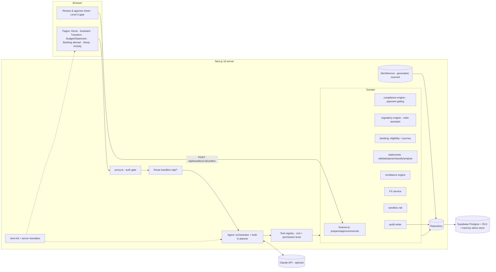

# CaiMao technical documentation

This document covers CaiMao's architecture, core algorithms and security design. Installation, environment variables, deployment and the demo script are in the [README](../README.md). Threats, privacy controls and known risks are in the [security self-assessment](security-self-assessment.md). The [execution evidence](execution-evidence/README.md) folder holds a real audit export of the main workflows.

## 1. What CaiMao does

CaiMao is an AI financial assistant for international students. It takes part in the student's finances: it reads their data, checks rules, compares options and prepares actions. Money moves only after the student approves each payment, and only in a sandbox.

| Workflow | Path through the system | Highest permission level used |
| --- | --- | --- |
| Pay tuition across borders | obligations → balances → FX → transfer rules → quotes → cost ranking → prepare → **student approves** → sandbox execution → balances and invoice updated | 3, after approval |
| Analyse a bank statement | consent → validate → parse on the server → mask → classify → preview → **student confirms** → analysis → insights | 1 |
| Cross-border rules | query → retrieve rules → evaluate → status + requirements + sources | 1 |
| Banking abroad | requirements → bank options → eligibility (or a question) → setup plan | 2 (plan) |
| My Financial Setup | journey built from profile, accounts, obligations, transfers and reference data | 2 (plan) |
| Language | profile setting → UI, server text and assistant replies | 2 (change) |

Supported countries for the new features: Singapore, China, the United Kingdom, the United States and Japan. Supported languages: English, Simplified Chinese and Japanese.

## 2. Architecture



**Layers**

- **Pages** are mostly server components. They read through the repository and pass plain data to small client components. Every user-visible string comes from `messages/*.json`.
- **Route handlers** (`app/api/*`) validate input with zod, resolve the signed-in user through `getRepository()` and call domain services. Errors map to typed HTTP responses (`lib/http.ts`).
- **The agent** (`lib/agent/`) exposes domain services as tools. Each tool declares a permission level, a zod schema and whether the model may call it.
  - **Claude mode** runs a tool-use loop when an API key is configured.
  - **The built-in planner** (`scripted.ts`) maps intents to fixed tool sequences and writes its replies only from tool results, in the user's language. It runs when there's no key and as the fallback if the model is unreachable.
- **Domain services** are pure functions where possible: the engines, the classifier and the analysis. Audited service wrappers call them and write audit events.
- **The repository** (`lib/data/repository.ts`) has two implementations: `MemoryRepository` for the demo and tests, and `SupabaseRepository` for Postgres with row-level security.
- **Reference data** (`lib/reference/`) is generated from researched source files. It's never hand-written in components.

**Design decisions**

- **One path for money.** Only `POST /api/transfers/:id/confirm` can move funds. It records the student's approval (`acknowledged: true`, actor = user) and then executes that approved request. The model has no tool that approves or executes.
- **Rules are data.** Both engines read `country_rules`, and the model can only quote what a tool returned. Unknowns become `NEEDS_VERIFICATION` or a clarifying question, never a guess.
- **Display-time translation.**
  - Reference rows carry reviewed translations of their descriptive text (`i18n`).
  - `lib/reference/localize.ts` overlays them for display. Flags, numbers, URLs and names the engines use are never translated.
  - Arrays are replaced only when they match item for item.
- **Demo mode on serverless hosts.** Vercel deploys pages and `/api` routes as two functions with separate memory. In demo mode the `/api` function is the source of truth, because every change goes through it. `proxy.ts` tags each request as `page` or `api`. Before a page renders, `lib/session.ts` pulls a snapshot of the mutable demo state from `GET /api/demo/state`; reference tables are left out. The snapshot is fetched once per request, and if the fetch fails the page renders from its own copy. The UI language follows the `CAIMAO_LOCALE` cookie, which every language change updates.
- **Evidence by construction.** Each workflow run has a correlation ID (`wf-`, `st-`, `rg-`, `bk-`, `fs-`). Every step writes an audit event with the actor, tool, permission level, result and details. The Activity & Security page groups events by run.

## 3. Data model

Migration `0001_schema.sql` holds the core money model: profiles, accounts, transactions, obligations, providers, quotes, transfer requests, payment executions, an append-only audit log and the atomic `commit_sandbox_execution` function.

Migration `0002_global_financial_setup.sql` adds:

| Table / change | Purpose | Access |
| --- | --- | --- |
| `profiles` + `nationality`, `visa_type`, `residency_status`, `student_status`, `age`, `tax_residency`, `language` | Personalisation and language | Owner reads; column grants allow owner updates |
| `country_rules` + `status`, `channel`, `direction`, `rule_category`, nationality/residency/visa conditions, `minimum_amount`/`maximum_amount`, `regulator`, `evidence_quote`, `i18n` | Structured regulatory data | Readable by signed-in users |
| check `country_rules_verified_has_source` | A verified rule must have an https official source and a last-verified date | Database-enforced |
| `banks`, `bank_account_requirements`, `credit_system_rules` | Researched bank and credit reference data | Readable by signed-in users |
| `user_financial_setup` | Journey progress and chosen bank | Owner reads; service writes |
| `statement_uploads` | Upload metadata (type, size, sha256, masked account hint, period, status, expiry). **No file column.** | Owner reads; service writes |
| `statement_transactions`, `statement_analyses` | Extracted rows and the confirmed analysis | Owner reads; service writes |
| `purge_expired_statement_previews()` | Removes unconfirmed previews after they expire | Service |

The memory store mirrors the same shapes (`lib/data/memory.ts`, store version 4).

## 4. Core algorithms

### 4.1 Remittance comparison (tuition)

For a send amount `S`, mid-market rate `m` and provider margin `k`:

```
transfer_fee   = fixed_fee + pct_fee × S
convertible    = S − transfer_fee − other_charges
recipient_gets = convertible × m × (1 − k)
total_cost     = transfer_fee + convertible × k + other_charges
```

Routes are ranked by `recipient_gets` at a common send amount, so a zero-fee route with a wide FX margin loses to a route that delivers more. For an invoice, CaiMao also solves for the exact send amount each provider needs. The explanation is generated as structured parts, so it renders in any language.

### 4.2 Payment gating (compliance engine)

`lib/compliance/engine.ts` evaluates the rules for a payment corridor:

- `block_above` → **BLOCKED** when the amount exceeds the limit.
- `documents_above` / `documents_always` → **ACTION_REQUIRED** until the documents are on file.
- `report_above` → informational.

`createTransferInstruction` re-runs the check on the server before preparing a payment. Researched rules join the payment check only when they're verified, apply to bank transfers and match the payer. Rules marked `needs_verification` and border-cash rules never gate a payment.

### 4.3 Cross-border rules assistant (regulatory engine)

`lib/regulatory/engine.ts`, audited by `lib/regulatory/service.ts`:

1. **RULE_QUERY.** The query holds source, destination, purpose, amount, currency and optionally nationality, residency and visa. Personal fields come from the profile unless the user describes someone else. The audit log records which personal fields were provided, not their values.
2. **RULE_RETRIEVED.** A rule applies to the sending side, the receiving side or both, according to its corridor and `direction`. Personal conditions are then checked:
   - a known mismatch excludes the rule;
   - an unknown value makes the rule **conditional** and records the missing field.
3. **RULE_EVALUATED.** Each rule gets a deterministic outcome:
   - `PASS` or `BLOCK` for limits;
   - `DOCUMENTS` or `PASS` for document rules (with document-equivalence, e.g. a university invoice satisfies "proof of payment purpose" for education);
   - `REPORT` for reporting thresholds;
   - `INFO` for disclosures and border-cash guidance;
   - `UNVERIFIED` for unverified rules;
   - `CONDITIONAL` when personal details are missing.
   Amounts are converted through the FX service into the rule's currency.
4. **Status**, in order of precedence:
   - no verified finding → `NEEDS_VERIFICATION`
   - a verified rule blocks → `BLOCKED`
   - missing details, a side of the corridor with no verified rule, or an unverified rule that could gate the payment → `NEEDS_VERIFICATION`
   - documents needed → `ACTION_REQUIRED`
   - otherwise → `COMPLIANT`
5. Whenever part of the answer couldn't be verified, the result carries the exact sentence *"I couldn't verify this requirement from the current regulatory database."* It also lists the countries that weren't covered. If details are missing, CaiMao asks for them (`CLARIFICATION_REQUESTED`).
6. **RESULT_PRESENTED.** The result includes requirements, documents, limits, considerations, the regulator and each official source with its last-verified date.

Whether CaiMao answers through Claude or the built-in planner, the model only narrates this structured result.

### 4.4 Bank eligibility

`lib/banking/eligibility.ts` returns one verdict per bank: `likely_eligible`, `check_with_bank`, `not_available` or `need_info`.

- **Missing details first.** If nationality, residency, visa, age or student status is unknown, every bank gets `need_info` and CaiMao asks for those details.
- **Hard exclusions.** Below the bank's stated minimum age, or a non-resident at a bank that states it requires residency → `not_available`.
- **Local citizens** → `likely_eligible` if the bank's facts are verified, otherwise `check_with_bank`.
- **International students:**
  - the bank's page states international students aren't eligible → `not_available`;
  - the page doesn't confirm eligibility → `check_with_bank`;
  - the person isn't a student on a student visa → `check_with_bank`;
  - otherwise → `likely_eligible`, always with a "varies by branch" reason.

Only facts stated on the bank's own page are used. `null` means not confirmed and never counts in the student's favour.

### 4.5 Statement pipeline

`lib/statements/`:

1. **Validate** (`validate.ts`):
   - size ≤ 4 MB (under Vercel's 4.5 MB request limit), checked from `Content-Length` before reading the body and again on the bytes;
   - file type from magic bytes as well as the extension. ZIP/XLSX/DOCX, executables, gzip and other binaries are rejected;
   - PDFs must be unencrypted and carry no `/JavaScript`, `/JS`, `/Launch`, `/EmbeddedFile` or `/RichMedia`;
   - a SHA-256 of the file is computed.
2. **Parse on the server, in memory.**
   - CSV: delimiter and header detection in English, Chinese and Japanese (date, description, debit/credit or signed amount, balance, currency), and several date and amount formats.
   - PDF: text extraction with `unpdf` (pdf.js), lines rebuilt from glyph positions. The running balance determines whether money went in or out when the sign is ambiguous.
3. **Normalise and mask** (`normalise.ts`):
   - IBANs, card and account numbers are reduced to `••••1234`;
   - email addresses are removed;
   - merchant names are cleaned of card-terminal prefixes and reference noise;
   - only a masked account hint (`••••7730`) is kept.
4. **Classify** (`lib/budget/classifier.ts`), deterministic first:
   1. a merchant dictionary (confidence 0.95);
   2. keyword rules, including bank abbreviations such as `TFR TO SAVINGS` (0.85);
   3. a fallback to Income or Other (≤ 0.5).
   Rows below 0.7 are flagged for review. The optional AI suggestion sees only masked merchant names of ambiguous card-style debits (see the self-assessment), and its suggestions stay flagged.
5. **Preview.** Rows are stored as a preview that expires after one hour. Nothing is analysed or kept long-term yet.
6. **Confirm** (`TRANSACTIONS_CONFIRMED`). The student can change categories and exclude rows. Confirming saves the rows and the analysis. **Balances and the main transaction ledger are never changed.**
7. **Analyse** (`analyse.ts`, `SPENDING_ANALYSED`):
   - totals: income, expenses (excluding own-account transfers), net, the essential/discretionary split, money out to transfers;
   - a monthly series, categories with shares, and top merchants;
   - **recurring payments**: same merchant, every amount within ±20 % of the median, median gap of 25–35 days (monthly, in at least 2 distinct months) or 6–8 days (weekly). The monthly cost is normalised and subscriptions are marked;
   - **unusual expenses**:
     - a payment over 3× its category's median, and at least 5 % of expenses, when the category has 3 or more payments;
     - otherwise, over 5× the overall typical payment and at least 10 % of expenses. Fixed categories (rent, tuition, transfers, fees) are excluded;
   - **income sources**: regular when seen in 2 or more months;
   - **estimated opportunity**:
     - with 2 or more months of data: for eating out, entertainment, shopping, travel and digital subscriptions, the latest month's spend above the earlier months' average, *excluding one-off outliers*;
     - otherwise, an illustrative 10 % of discretionary spend.
     It's always labelled an estimate, never "guaranteed savings";
   - **projection**: cash now plus the average monthly net, minus payments due before the next large obligation.
8. **Insights** are stored as codes with parameters (e.g. `category_above_average {category, month, amount, diff, months}`). They render in any language, in the UI and in the assistant, so text never carries numbers the analysis didn't compute.

### 4.6 My Financial Setup

`lib/banking/journey.ts` builds the 8-step plan for a study country:

1. documents
2. local bank account
3. receiving money from home (inbound rules + documents)
4. compare tuition routes
5. pay tuition
6. recurring payments
7. local credit
8. relevant restrictions

A step ticks itself (`auto`) when CaiMao can see the evidence:

- at least two documents on file;
- a local bank account;
- a home and a local account;
- a tuition transfer has been prepared;
- tuition is paid;
- a local card exists.

Otherwise the student ticks it. When the study country is the home country, the two cross-border steps show "not needed". Creating the plan is a Level 2 action (`ACTION_PLAN_CREATED`).

### 4.7 Languages

- **Locale.** next-intl without locale routes. The locale is `profiles.language`, mirrored in a `CAIMAO_LOCALE` cookie for the public screens.
- **Fallback.** `i18n/request.ts` deep-merges English underneath the chosen language.
- **Server text.** The built-in planner, the regulatory explanations and the insights are rendered from message keys with the same translator (`lib/i18n/translator.ts`), and the Claude agent is told to reply in the user's language.
- **Assistant intents.** The built-in planner's intent and fact extraction understands Chinese and Japanese. A test checks that every suggestion chip routes to the same workflow in all three languages.
- **Formatting.** Dates use the locale; money keeps ISO currency codes.
- **Never translated.** Bank names, product names, regulator names, form names and transaction IDs stay as they are.

## 5. Agent and permissions

| Level | Meaning | Examples |
| --- | --- | --- |
| 0 Information | Public or reference information | `getFXRate`, `calculateTransferCost`, `getCountryBankingRequirements`, `getAvailableBanks`, `getCreditSystemInfo` |
| 1 Read | The user's own data | `getAccounts`, `getTransactions`, `getTransferRules`, `getUserFinancialProfile`, `getFundFlowRules`, `getBankEligibility`, `getRequiredDocuments`, `analyseSpending`, `generateSavingsInsights`, `getLanguagePreference`, `parseBankStatement`, `classifyTransactions` |
| 2 Prepare | Create something the user can act on; nothing moves | `createTransferInstruction`, `getAccountSetupSteps` (plan), `updateLanguagePreference` |
| 3 Execute | Move money, only after per-transaction approval | `executeSandboxTransfer`, `updateAccountBalance`, `markObligationPaid`. **Not offered to the model**; reached only through the approval endpoint |

How these are enforced:

- `runTool` calls `assertPermission` before running any tool the agent invokes. A tool is allowed only if its level is at most 2 and at most the user's chosen AI permission (Settings → *How CaiMao can help*, 0–2). Anything else is refused and logged as `PERMISSION_DENIED`, so Level 3 can never be a standing permission.
- Statement parsing and classification aren't model tools. They run only inside the upload flow, after consent.

## 6. Security design (summary)

Details, threats and known risks are in [security-self-assessment.md](security-self-assessment.md).

- **Authentication.**
  - Supabase Auth, or in demo mode an HMAC-signed `httpOnly` cookie.
  - `proxy.ts` protects pages and APIs, and every handler resolves the user again.
- **Authorisation.**
  - Row-level security on every table: owners read their own rows, and there are no client write policies on money or statement tables. Column grants limit what a user can update on their profile.
  - The database function and constraints re-check approval, acknowledgement and compliance at execution.
- **Approval.**
  - Per-transaction confirmation (`acknowledged: true`).
  - Compare-and-set state transitions: one approval, one execution.
  - A prepared transfer expires if it isn't approved within 15 minutes.
- **Regulatory integrity.**
  - Rules come only from structured data.
  - The database refuses a verified rule without a source; tests check every researched row has an official https source and a last-verified date.
  - The fallback is `NEEDS_VERIFICATION` with the exact sentence.
- **Statement privacy.**
  - Consent required.
  - The file is parsed in memory and never stored or given a URL.
  - Identifiers masked; previews expire; the student can delete at any time.
  - Minimal data to the AI model; balances never changed.
- **Secrets.** Server-only. Nothing secret is prefixed `NEXT_PUBLIC_`.
- **Audit.**
  - Append-only (a database trigger rejects `UPDATE` and `DELETE`).
  - JSON export of executions, transfer requests, statement metadata and every audit event.

## 7. Reference data pipeline

```
official sources ──research──▶ data/reference-research/{SG,CN,GB,US,JP}.json (url, evidence quote, confidence)
                                  │   + scripts/reference/overrides.py (modelling decisions, skips)
                                  │   + data/reference-research/i18n.json (reviewed zh-CN / ja text)
                                  ▼
                     python3 scripts/reference/build.py
                                  ▼
         lib/reference/{rules,banks,account-requirements,credit-systems}.ts (typed, generated)
```

The current dataset was researched on 18 October 2026:

- 81 rules (79 verified, 2 marked `needs_verification`);
- 24 banks;
- 5 account-opening overviews and 5 credit systems.

Domestic-only items (for example UK fraud reimbursement) and account-opening identity rules are skipped as transfer rules; the account-opening rules appear under Banking Abroad instead. To update the data, edit the research JSON, run the build script and run `npm test`.

## 8. Testing

`npm test` runs 127 tests in nine files:

| File | Covers |
| --- | --- |
| `tuition-workflow.test.ts` | The original tuition workflow |
| `sql.test.ts` | Both migrations against PostgreSQL via PGlite: RLS, constraints, the atomic commit, append-only audit, statement RLS |
| `statements.test.ts` | Statement upload |
| `global-setup.test.ts` | Banking, regulation, language and regression |
| `agent-i18n.test.ts` | The assistant in three languages |
| `privacy.test.ts` | What the AI model may see |
| `budget.test.ts` | Budgeting |
| `agent-fallback.test.ts` | Model fallback |
| `demo-session.test.ts` | Demo sign-in and demo state work across separate server processes (Vercel runs pages and `/api` as separate functions) |

`npm run lint` type-checks the project, and `npm run build` is the production build Vercel runs.
